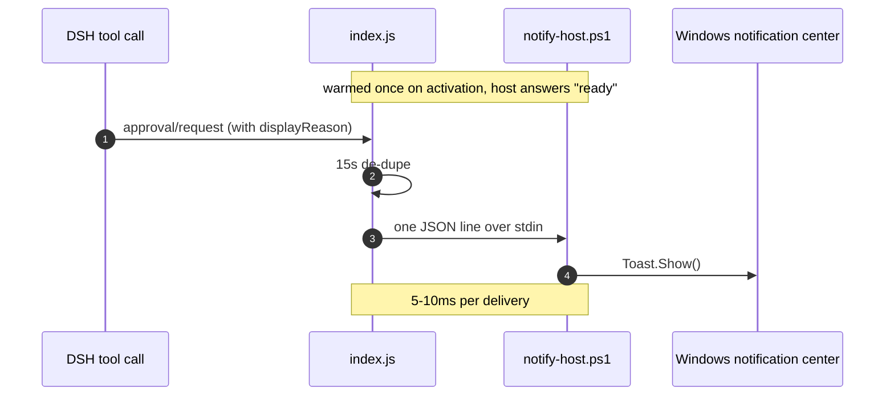

# Windows Approval Notify

**A Windows toast pops up the instant DSH needs your approval.**

[](#requirements)
[](LICENSE)
[](https://github.com/)

**English** · [简体中文](README.md)

---

## Why

When a long DSH job runs in the background and one of its operations needs approval, DSH waits for you in its own window — a window that is very likely buried behind others, minimized, or on a screen you're not looking at. A task that should have taken three seconds ends up waiting ten minutes for a click.

This plugin moves "waiting for approval" out of the DSH window and into the Windows notification center: the moment an approval request is raised, a system toast appears (attributed to **DeepSeek Harness**), so you notice it while doing something else entirely.

## What it does, and what it doesn't

| | |
| --- | --- |
| ✅ Does | Listens to DSH approval events and forwards their prompt text as a Windows toast |
| ❌ Doesn't | Decide approvals, alter outcomes, click "Allow" for you, log approval content, or touch the network |

It is a **read-only, one-way notification channel**. Remove it and the DSH approval flow is exactly as it was.

## Features

- **Fast** — a persistent PowerShell notification host is pre-warmed when the plugin activates, so each toast costs 5–10ms. You won't see the DSH dialog first and the toast second.
- **Same wording** — reuses the exact text DSH itself shows, so the two never disagree.
- **No spam** — every approval in a burst reuses one notification tag, so a new toast replaces the old one instead of piling up.
- **No duplicates** — the same request is announced once within a 15-second window, even though two event paths can both see it.
- **Never in the way** — if the host process is killed or crashes it restarts with exponential backoff, falling back to a one-shot spawn so nothing is dropped. The approval flow itself is never affected.

## Requirements

- Windows 10 / 11, with system notifications enabled (Do Not Disturb / Focus Assist may swallow them).
- `powershell.exe` (ships with Windows).
- Toasts are published under `com.deepseek.dsh` (the DSH desktop app's AppUserModelID), which is why the card reads **DeepSeek Harness**.

> On non-Windows platforms the plugin silently no-ops.

## Install

Clone the repository anywhere:

```bash
git clone https://github.com/<your-username>/dsh-windows-approval-notify.git
```

Then, inside DSH:

```text
plugin_manager install_bundle target = <absolute path to this directory>
```

For example:

```text
plugin_manager install_bundle target = G:\DS-test\plugins\dsh-windows-approval-notify
```

The plugin row takes effect immediately — no restart needed.

To uninstall:

```text
plugin_manager remove_bundle target = @local/dsh-windows-approval-notify
```

## How it works

Two trigger paths, so nothing is missed and nothing is doubled:



1. **Primary path** — a `prepend` waterfall hook on `approval/request`, so we read the request (and its `displayReason`) before any other answerer can claim it.
2. **Fallback path** — if another answerer claims the request first, we listen for the persisted `approval/asked` session event and fire 120ms later, giving the richer request a chance to arrive first.

Delivery goes through a **persistent PowerShell process**: started and handshaked with `ready` when the plugin activates; afterwards each notification is a single JSON line on stdin. The host parses it, calls the WinRT `ToastNotificationManager` and answers `ok`. Compared with spawning a fresh PowerShell per toast (~270ms startup), this is one to two orders of magnitude faster in practice.

If the host dies, it restarts on a 2s → 30s exponential backoff, and any pending notification is delivered by a one-shot spawn in the meantime.

## Notification content

| Element | Value |
| --- | --- |
| Title | Always `DSH 需要提权` |
| Body | `displayReason` (tries `zh` / `zh-CN` / `zh-Hans` / `en`), then `reason`, then `<tool> is requesting your approval` |
| Length | Body capped at 220 characters, truncated with `…` |
| Tag | `Tag = dshApproval`, `Group = dshNotify` (same-tag toasts replace each other) |

## Project layout

| File | Purpose |
| --- | --- |
| `index.js` | Host plugin: event listeners, de-dupe, notification channel (persistent process + backoff restart + one-shot fallback) |
| `notify-host.ps1` | Plain-ASCII PowerShell notification host; reads JSON lines from stdin and raises WinRT toasts |
| `cordis.patch.yml` | Injection patch that adds the `windows-approval-notify` row |
| `locale/zh.json`, `locale/en.json` | Title and description shown by the plugin manager |
| `icon.svg` | Plugin icon |
| `package.json` | Package metadata and DSH bundle declaration |

## FAQ

**No notification at all?**
Check Settings → System → Notifications and make sure "DeepSeek Harness" is allowed; also check Do Not Disturb / Focus Assist. If the entry isn't listed at all, the DSH desktop app hasn't registered its AppUserModelID yet and Windows drops the toast.

**The toast shows up before I see the DSH dialog?**
By design — the notification rides the event stream and can beat DSH's own render. Same content, just sooner.

**Will it spam me?**
No. Each approval request is de-duped by `callId` (falling back to `tool|reason`) for 15 seconds, and same-tag toasts replace each other.

**Several approvals at once?**
Only the last one stays in the notification center. A deliberate trade-off: better to lose one line of history than to bury you in toasts.

**Can I change the wording or add a sound?**
There are no options in this version; wording tracks DSH. To change it, `TITLE` at the top of `index.js` and the toast XML inside `notify-host.ps1` are the only two places to touch.

## Contributing

Issues and PRs are welcome. Please open an issue before larger changes, especially anything touching how events are observed or how toasts are delivered — those two are the whole basis of the "never interferes with DSH" promise.

## License

[MIT](LICENSE) © DSH Windows Approval Notify contributors
