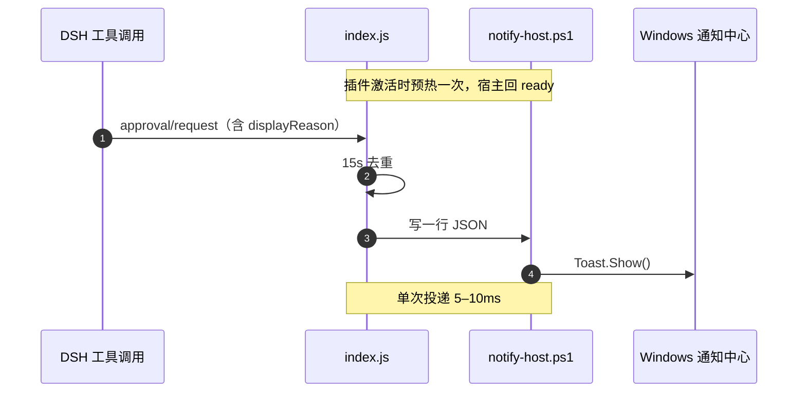

# Windows 提权通知

**DSH 需要你授权的那一刻，Windows 通知立刻弹出来。**

[](#环境要求)
[](LICENSE)
[](https://github.com/)

[English](README.en.md) · **简体中文**

---

## 为什么需要它

DSH 在后台跑长任务时，一旦某个操作需要提权，它会在自己的窗口里等你的授权——而那个窗口此刻很可能被别的窗口盖着、最小化了，或者你压根不在电脑前。于是一个本该 3 秒结束的任务，卡在那里等了你十分钟。

这个插件把「等待授权」这件事从 DSH 窗口里搬到 Windows 通知中心：审批请求产生的同一瞬间，屏幕上会弹出一条系统通知（显示为 **DeepSeek Harness**），你在做别的事也能第一时间看到。

## 它做什么，不做什么

| | |
| --- | --- |
| ✅ 做 | 监听 DSH 的审批事件，把提示文案转发成一条 Windows Toast 通知 |
| ❌ 不做 | 不做授权决策、不改变审批结果、不代替你点击「允许」、不记录审批内容、不联网 |

它是一条**只读的单向通知通道**。删掉它，DSH 的审批流程和原来完全一样。

## 特性

- **快** —— 常驻的 PowerShell 通知宿主在插件激活时预热，之后每次弹窗只需 5–10ms，不会让你先看到 DSH 弹窗再等系统通知。
- **文案一致** —— 直接复用 DSH 自己弹窗里的提示，不另造一套措辞。
- **不刷屏** —— 同一批审批复用同一个通知标签，新通知替换旧通知，通知中心不会被堆满。
- **不重复** —— 同一请求在 15 秒内只提醒一次，事件双路径触发也只弹一条。
- **坏了不影响 DSH** —— 通知宿主进程被杀或异常退出时自动退避重启，期间退化为一次性弹窗兜底，绝不影响审批本身。

## 环境要求

- Windows 10 / 11，且**系统通知未被关闭**（勿扰 / 专注助手可能拦截）。
- `powershell.exe`（Windows 自带，无需额外安装）。
- 通知以 `com.deepseek.dsh`（DSH 桌面端的 AppUserModelID）身份发布，所以通知卡片显示为 **DeepSeek Harness**。

> 非 Windows 平台下插件会静默跳过，不做任何事。

## 安装

把仓库克隆到任意目录：

```bash
git clone https://github.com/<你的用户名>/dsh-windows-approval-notify.git
```

然后在 DSH 里执行：

```text
plugin_manager install_bundle target = <仓库的绝对路径>
```

例如：

```text
plugin_manager install_bundle target = G:\DS-test\plugins\dsh-windows-approval-notify
```

插件行立即生效，无需重启 DSH。

卸载：

```text
plugin_manager remove_bundle target = @local/dsh-windows-approval-notify
```

## 工作原理

两条路径触发，保证「不漏」也「不重」：



1. **主路径** —— 以 `prepend` 方式挂 `approval/request` 瀑布钩子，抢在其它 answerer 之前读到携带 `displayReason` 的请求。
2. **兜底路径** —— 如果请求被别的 answerer 抢先认领，则监听已落库的 `session/event` 事件里的 `approval/asked`，延迟 120ms 触发（等待带 `displayReason` 的请求先到）。

投递层是一个**常驻的 PowerShell 进程**：插件激活时启动并握手 `ready`，之后每次通知只往 stdin 写一行 JSON，宿主解析后调用 WinRT `ToastNotificationManager` 弹窗，回一行 `ok`。相比每次 `spawn` 一个新的 PowerShell（约 270ms 启动开销），这个方案实测快一到两个数量级。

宿主异常退出时按 2s → 30s 指数退避重启；退避期间若有待发通知，走一次性 spawn 兜底，保证不丢。

## 通知内容

| 元素 | 取值 |
| --- | --- |
| 标题 | 固定为 `DSH 需要提权` |
| 正文 | `displayReason`（依次尝试 `zh` / `zh-CN` / `zh-Hans` / `en`）→ 退化到 `reason` → 退化到 `<工具名> 正在请求你的授权` |
| 长度 | 正文最多 220 字符，超出以 `…` 截断 |
| 标签 | `Tag = dshApproval`、`Group = dshNotify`（同标签的通知互相替换） |

## 项目结构

| 文件 | 作用 |
| --- | --- |
| `index.js` | Host 插件：事件监听、去重、通知通道（常驻进程 + 退避重启 + 一次性兜底） |
| `notify-host.ps1` | 纯 ASCII 的 PowerShell 通知宿主，从 stdin 逐行读 JSON，调用 WinRT Toast API |
| `cordis.patch.yml` | 插件注入补丁，插入 `windows-approval-notify` 一行 |
| `locale/zh.json`、`locale/en.json` | 插件管理器里显示的标题与描述 |
| `icon.svg` | 插件图标 |
| `package.json` | 包元数据与 DSH bundle 声明 |

## 常见问题

**通知完全没出现？**
先确认 Windows 设置 → 系统 → 通知里「DeepSeek Harness」是允许状态，并检查是否开了勿扰 / 专注助手。若列表里没有这一项，说明 DSH 桌面端尚未注册 AppUserModelID，通知会被系统丢弃。

**通知出现得比我看到的 DSH 弹窗还早？**
这是设计如此——通知走事件流，理论上可以早于 DSH 自己的渲染。两者内容一致，只是通知更快。

**会重复弹很多条吗？**
不会。同一次审批请求按 `callId`（无则按 `工具名|reason`）在 15 秒内去重，且同标签通知互相替换。

**多个审批同时到达会怎样？**
只有最后一条会留在通知中心——这是刻意的取舍：宁可少一条历史记录，也不要弹出一堆通知把你淹掉。

**能改文案或加声音吗？**
当前版本没有配置项，文案与 DSH 保持一致。想改的话，`index.js` 顶部的 `TITLE` 与 `notify-host.ps1` 里的 toast XML 是唯一需要动的地方。

## 贡献

欢迎 issue 和 PR。改动前请先开 issue 说明意图，尤其是会触及事件监听方式或通知投递策略的改动——这两块是"不影响 DSH 主流程"这个承诺的关键。

## License

[MIT](LICENSE) © DSH Windows Approval Notify contributors

